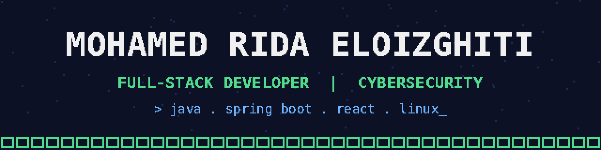

  

  
  
  

## 👨‍💻 About me

I'm a **full-stack web developer** and the **IT Manager (Responsable SI) at CLIXA**. I build and ship real products, from the API to the UI, and I'm growing into **networking, Linux and cybersecurity**.

| | |
|---|---|
| 🏢 **Now** | IT Manager at CLIXA: I built and run [clixa.africa](https://www.clixa.africa) and [clixaconseil.com](https://www.clixaconseil.com) |
| 🎓 **Education** | DUT in Computer Engineering (EST Fkih Ben Salah) · Computer Science at SUPTECH |
| 🔐 **Security** | Web penetration testing and vulnerability assessment (internship report with CVSS-rated findings) |
| 🌍 **Open to** | Full-time roles in Morocco, remote positions abroad, freelance web projects |

## 🧰 Tech stack

| Area | Tools |
|---|---|
| **Backend** |       |
| **Frontend** |      |
| **Data** |   |
| **DevOps** |      |
| **Security** |    |

## 🚀 Featured projects

| Project | Description | Stack | Links |
|:---|:---|:---|:---:|
| 🎓 **CLIXA Institute** | Online training platform for professionals across Africa: program catalog, enrollment, online certificate verification | Next.js · TypeScript | [🌐 Live](https://www.clixa.africa) |
| 💼 **CLIXA Consulting** | Website of CLIXA's consulting branch: ERP Odoo, digitalization, AMOA | React · TypeScript · Tailwind | [🌐 Live](https://www.clixaconseil.com) · [💻 Code](https://github.com/clixatravo/clixa-consulting) |
| 🎬 **Netfarjo** | Movie & series discovery app with search, watchlist and an Android build | Spring Boot · Neo4j · React · TS | [🌐 Live](https://netfarjo.vercel.app) · [💻 Code](https://github.com/Marriio0/netfarjo) |
| 📑 **PFE-Manager** | Platform to manage final-year project reports: versions, comments, validation | Laravel · React | [🌐 Live](https://testwebsitepfe.vercel.app) · [⚙️ API](https://github.com/Marriio0/PFE-Manager) · [🖥️ Front](https://github.com/Marriio0/pfe-manager-frontend) |

## 💼 Experience

| Role | Company | Period |
|:---|:---|:---:|
| **IT Manager (Responsable SI)** | CLIXA | Aug 2026 – now |
| **Software Developer Intern (PFE)** · Spring Boot, Neo4j, OAuth 2.0 | OBENS Trace Solutions, Agadir | Apr – Jun 2026 |
| **Cybersecurity Intern** · web penetration testing | StratExcelLance, Casablanca | Jul – Aug 2025 |

---

  <b>Let's build something together.</b> 
  <a href="https://www.linkedin.com/in/eloizghiti">Message me on LinkedIn</a>

